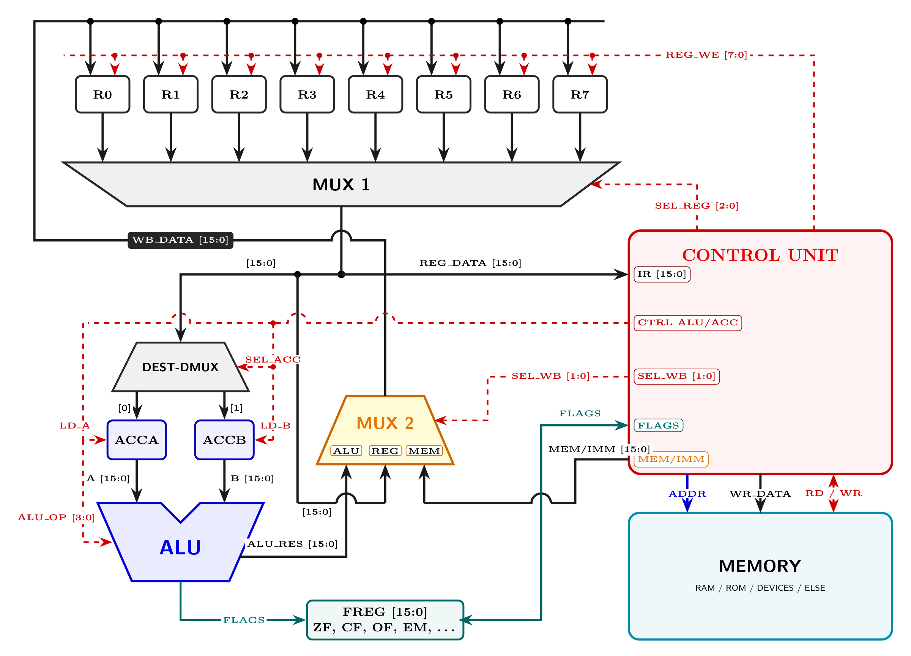

# Архитектура процессора LIM M2

<p align="center">
  
</p>

<p align="center">
  <b>Высокопроизводительное 16-битное микропрограммное процессорное ядро с активной мультиплексорной маршрутизацией (Zero Tri-State) и 24-битной линейной адресацией (16 МБ)</b>
</p>

<p align="center">
  <a href="README.md"><b>English</b></a> •
  <a href="README.ua.md"><b>Українська</b></a> •
  <a href="README.ru.md"><b>Русский</b></a> •
  <a href="README.sk.md"><b>Slovenčina</b></a>
</p>

---

## 🌟 Ключевые архитектурные достоинства

* **Чистый мультиплексорный тракт данных (Zero Tri-State / отказ от Hi-Z):**
  Полный отказ от внутренних шин третьего состояния (`Hi-Z`). Потоки данных управляются исключительно активными селекторными деревьями (`MUX 1`, `DEST-DMUX`, `MUX 2`). Это полностью устраняет сквозные токи, шинные конфликты (bus contention) и паразитные ёмкостные задержки. Идеально для синтеза в современные FPGA и ASIC.
* **Расширенная 24-битная линейная адресация памяти и стека (до 16 МБ):**
  Аппаратная поддержка выделенных 24-битных регистров:
  * **`PTREG` (Pointer Register):** Линейная прямая адресация памяти до 16 МБ с аппаратным автоинкрементом (`AIP`).
  * **`SREG` (Stack Register):** Полноценный 24-битный указатель стека для процедурных вызовов и глубоких кадров рекурсии.
* **Двухаккумуляторный исполнительный узел (`ACCA` и `ACCB`):**
  Предалушные регистры-защёлки надёжно стабилизируют операнды перед АЛУ, изолируя переходные процессы вычислений от основного регистрового файла (`R0–R7`).
* **Прямой тракт межрегистровой пересылки (Reg-to-Reg Bypass):**
  Выделенный канал из `MUX 1` напрямую в `MUX 2` выполняет пересылку между регистрами (`LRR / MOV`) за 1 шаг без задействования и блокировки ресурсов АЛУ.
* **Аппаратное автокаскадирование длинной арифметики (ALU Auto-Chaining):**
  АЛУ содержит внутренний остаточный аккумулятор (`ALU_RESIDUAL`):
  * **Каскадное сложение (`ADD`):** Если сумма $> 2^{16}-1$, перенос (`+1`) фиксируется и автоматически суммируется в следующем `ADD`.
  * **Каскадное вычитание (`SUB`):** Если разность $< 0$, заём (`-1`) запоминается и автоматически вычитается в следующем `SUB`.
  * **Каскадное умножение (`MUL`):** Младшие 16 бит уходят в целевой регистр; старшие 16 бит фиксируются в `ALU_RESIDUAL` и могут автоматически суммироваться в последующих операциях.
  * **Каскадное деление (`DIV`):** Частное записывается в целевой регистр; остаток от деления (modulo) сохраняется в `ALU_RESIDUAL`.
  * **Сброс цепочки (`NOP`):** Инструкция `NOP` сбрасывает `ALU_RESIDUAL` и флаги каскадной цепочки для начала новых независимых вычислений.
* **Высокочастотный потенциал:**
  Рассчитан на базовую частоту **200~МГц**, масштабируясь до **700~МГц и выше** в специализированном кремнии (ASIC).

---

## 📑 Официальная техническая документация

Полные готовые к печати PDF-даташиты находятся в папке [`Docs/`](Docs/):

| Язык | Исходный код LaTeX | Скомпилированная PDF спецификация |
| :--- | :--- | :--- |
| **Русский** | [`Docs/LIM_M2_Datasheet_RU.tex`](Docs/LIM_M2_Datasheet_RU.tex) | [**Скачать PDF (RU)**](Docs/LIM_M2_Datasheet_RU.pdf) |
| **English** | [`Docs/LIM_M2_Datasheet_EN.tex`](Docs/LIM_M2_Datasheet_EN.tex) | [**Скачать PDF (EN)**](Docs/LIM_M2_Datasheet_EN.pdf) |
| **Українська** | [`Docs/LIM_M2_Datasheet_UA.tex`](Docs/LIM_M2_Datasheet_UA.tex) | [**Скачать PDF (UA)**](Docs/LIM_M2_Datasheet_UA.pdf) |
| **Slovenčina** | [`Docs/LIM_M2_Datasheet_SK.tex`](Docs/LIM_M2_Datasheet_SK.tex) | [**Скачать PDF (SK)**](Docs/LIM_M2_Datasheet_SK.pdf) |

---

## 🗃️ Архитектурный регистровый файл

| Регистр | Разрядность | Функциональное назначение |
| :--- | :---: | :--- |
| **`R0` – `R7`** | 16 бит | Регистры общего назначения (GPR). Быстрое считывание через `MUX 1`, стробированная запись с шины `WB_DATA`. |
| **`SREG`** | **32 бита** | Системный регистр стека. Линейная 32-битная адресация стекового пространства до 4 ГБ. |
| **`PTREG`** | **32 бита** | Расширенный регистр-указатель. Линейная адресация памяти до 4 ГБ с аппаратным автоинкрементом (`AIP`). |
| **`FREG`** | 16 бит | Регистр состояния и управления процессора (бит 11: `PRV` — режим User/Supervisor). |
| **`ACCA` / `ACCB`** | 16 бит | Служебные аккумуляторы АЛУ. Фиксируют операнды A и B перед вычислением. |
| **`$ir0`..`$ir15`** | **32 бита** | 16 векторных регистров адресов обработчиков аппаратных прерываний. |
| **`$pv0`..`$pv15`** | **32 бита** | 16 векторных регистров границ 8 Зон Привилегий (`[$pv0:$pv1]`..`[$pv14:$pv15]`). |

### Битовая карта регистра флагов и управления (`FREG`)

```text
 15    14    13    12   11   10    9    8    7    6    5    4    3    2    1    0
+-----+-----+-----+----+----+----+----+----+----+----+----+----+----+----+----+----+
|INTR |SMOD |DBIT |AIP |PRV |DWR |MIE |PIE |CLK1|CLK0|CMP1|CMP0| EM | OF | CF | ZF |
+-----+-----+-----+----+----+----+----+----+----+----+----+----+----+----+----+----+
```

* **`ZF` (0):** Флаг нуля (Zero Flag).
* **`CF` (1):** Флаг переноса / заёма (Carry Flag).
* **`OF` (2):** Флаг знакового переполнения (Overflow Flag).
* **`EM` (3):** Аппаратная ловушка математических ошибок (Error Math: деление на ноль).
* **`CMP` (4–5):** Результат аппаратного компаратора `cmp_flags` (`00`: начальный сброс / ничего не сравнивалось / ошибка; `01`: операнд-1 < операнд-2; `10`: операнд-1 == операнд-2; `11`: операнд-1 > операнд-2).
* **`CLK` (6–7):** Профиль делителя тактовой частоты.
* **`PIE` (8):** Разрешение программных прерываний.
* **`MIE` (9):** Разрешение внешних маскируемых прерываний.
* **`DWR` (10):** Безакцептный обмен без ожидания шины.
* **`PRV` (11):** Режим привилегий процессора (`0`: User Mode, `1`: Supervisor Mode). Аппаратно защищён 8 зонами привилегий `$pv0..$pv15`.
* **`AIP` (12):** Автоинкремент указателя `PTREG` при обращении к памяти.
* **`DBIT` (13):** Буфер вытесненного бита сдвигового узла.
* **`SMOD` (14):** Режим сдвига (`0`: заполнение нулями; `1`: циклический проход через `DBIT`).
* **`INTR` (15):** Флаг нахождения в прерывании (`1`: процессор обслуживает прерывание; повторные прерывания заблокированы).

---

## 📐 Форматы машинных инструкций и битовое декодирование

Процессор LIM M2 реализует ортогональную систему кодирования с детерминированным декодированием:
* **Единая архитектурная парадигма:** Сначала приёмник (куда), затем операнды (откуда):
  * **Арифметика (3 операнда):** `ADD Rd, Rs1, Rs2` $\implies \text{Rd} = \text{Rs1} + \text{Rs2}$
  * **Логика (2 операнда):** `AND Rd, Rs` $\implies \text{Rd} = \text{Rd} \ \& \ \text{Rs}$
  * **Унарные (1 байт, 1 операнд):** `NOT Rd`, `INC Rd`, `DEC Rd`
  * **Пересылка:** `LRR Rd, Rs` $\implies \text{Rd} = \text{Rs}$ (копирование из точки Б в точку А)
  * **Компаратор:** `CMP Rs1, Rs2` $\implies$ формирует `FREG.CMP` (`01`: `<`, `10`: `=`, `11`: `>`, `00`: сброс/ошибка)
* **Прямое кодирование первого аргумента и модификаторов:** 5-битный опкод в битах `[7:3]` октета 0, а биты `[2:0]` напрямую кодируют первый регистровый аргумент (`Rd` / `Rs1` / `Rs`) в арифметике, логике, пересылке, сравнении и стековых операциях, либо модификаторы адресации/управления (`CFG` / `MOD` / `SZ:Mode`), где это применимо.

### Универсальный битовый шаблон
```
+------------------------+-------------------+------------------------------------------+
|      OPCODE [7:3]      |   Rd / CFG [2:0]  | Операнды и аргументы (динамич. длина)    |
|        (5 бит)         |     (3 бита)      |             (0--3 октета)                |
+------------------------+-------------------+------------------------------------------+
  Бит 7                3   Бит 2           0   Байт 1 ... Байт 3 (опционально)
```

### 10 классов инструкций и структура полей

1. **Класс I: Однобайтовые инструкции (1 байт, 0 доп. байт)**
   * `NOP`, `HALT`, `CLI`, `STI`, `RET` (`CFG = 000`)
   * `NOT Rd`, `INC Rd`, `DEC Rd` (`Биты [2:0] = Rd` прямо задают регистр, второй байт из шины памяти не выбирается)
   ```
   Октет 0: [ OPCODE (5б) | Rd / 000 (3б) ]
   ```

2. **Класс II: Трёхоперандная арифметика (2 байта)**
   * `ADD`, `SUB`, `MUL`, `DIV`, `MOD` (`Rd = Rs1 op Rs2`)
   ```
   Октет 0: [ OPCODE (5б) | Rd [2:0] (Приёмник) ]
   Октет 1: [ Rs1 [7:5] (Операнд 1) | Rs2 [4:2] (Операнд 2) | RSV=00 [1:0] ]
   ```

3. **Класс III: Двухоперандная логика (2 байта)**
   * `AND`, `OR`, `NAND`, `NOR`, `XOR`, `XNOR` (`Rd = Rd op Rs`)
   ```
   Октет 0: [ OPCODE (5б) | Rd [2:0] (Приёмник/Оп1) ]
   Октет 1: [ Rs [7:5] (Операнд 2) | RSV=00000 [4:0] ]
   ```

4. **Класс IV: Межрегистровое перемещение LRR (2 байта)**
   * `LRR Rd, Rs`: прямое копирование из источника (точка Б, `Rs`) в приёмник (точка А, `Rd`) через байпас `MUX 1` $\to$ `MUX 2` (1 такт, `FREG` не меняется).
   ```
   Октет 0: [ 00111 (5б) | Rd [2:0] (Приёмник) ]
   Октет 1: [ Rs [7:5] (Источник) | RSV=00000 [4:0] ]
   ```

5. **Класс V: Аппаратный компаратор CMP (2 байта)**
   * `CMP Rs1, Rs2`: неразрушающее сравнение с фиксацией в `FREG.CMP` (`01`: `<`, `10`: `=`, `11`: `>`, `00`: сброс/ошибка).
   ```
   Октет 0: [ 01000 (5б) | Rs1 [2:0] (Операнд 1) ]
   Октет 1: [ Rs2 [7:5] (Операнд 2) | RSV=00000 [4:0] ]
   ```

6. **Класс VI: Аппаратный сдвиг на D-триггерах (2 байта, тактовый цикл)**
   * `BSL Rd, shift` и `BSR Rd, shift`: итеративный регистр сдвига на 16 D-триггерах ($\approx 300$ транзисторов вместо $\approx 30\,000$ у матричного узла).
   * **Потактовое исполнение в железе:** сдвиг на 16 бит занимает на 15 тактов дольше, чем сдвиг на 1 бит (1 такт на 1 бит).
   * Управляется флагами `FREG.SMOD` (`1`: ротация через `DBIT`, `0`: заполнение нулями) и `FREG.DBIT` (буфер последнего выброшенного бита).
   ```
   Октет 0: [ OPCODE (5б) | Rd [2:0] (Сдвигаемый регистр R0--R7) ]
   Октет 1: [ Счётчик тактов shift [7:0] (0--16 тактов / бит) ]
   ```

7. **Класс VII: Операции со стеком (2 байта)**
   * `PUSH Rs` и `POP Rd`: пословный обмен со стеком по 32-битному указателю `SREG`.
   ```
   Октет 0: [ OPCODE (5б) | Rs / Rd [2:0] (Регистр R0--R7) ]
   Октет 1: [ RSV=00000000 [7:0] ]
   ```

8. **Класс VIII: Манипуляция специальными регистрами (2–6 байтов)**
   * `MSP sreg, [op], args`: прямое чтение/запись или функциональная модификация `FREG` (00), 32-битного `PTREG` (01), 32-битного указателя стека `SREG` (10) или 32 векторных 32-битных регистров `VEC` (11: `$ir0..$ir15` прерываний и `$pv0..$pv15` защищенных зон привилегий).
   ```
   Октет 0: [ 11010 (5б) | Mode (1б: 0=Загрузка/LD, 1=Модификация) | SREG (2б: 00=FREG, 01=PTREG, 10=SREG, 11=VEC) ]
   Октет 1 (VEC, 11):      [ Vector_ID [7:3] (0..31: ir0-15 / pv0-15) | Source [2:1] (00=Reg, 01=Imm32, 10=[$ptreg], 11=Ptr) | Sub/PtrType [0] ]
   Октет 2 (VEC Reg/Ptr):  [ Rd_hi [7:5] (старшие 16 бит) | Rs_lo [4:2] (младшие 16 бит) | RSV=00 [1:0] ] (для Source=00 или 11-reg)
   Октет 1 (FREG Загрузка): [ Rs [7:5] | RSV [4:3] | Source [2:1] | RSV [0] ]
   Октет 1 (FREG Логика):   [ OP [7:6] (00=AND, 01=OR, 10=XOR, 11=XNOR) | Rs [5:3] / RSV | Source [2:1] | RSV [0] ]
   Октет 1 (PTREG/SREG LD): [ Rd_hi [7:5] | Rs_lo [4:2] | Source [1:0] ]
   Октет 1 (PTREG/SREG Ариф): [ OP [7] (0=ADD, 1=SUB) | Rs [6:4] | Source [3:2] | RSV [1:0] ]
   ```

9. **Класс IX: Инструкции ветвления и переходов (2--6 байт)**
   * `JMP`, `JCR`, `JNZ`, `JZ`:
     * `MOD = 0` (000): 16-битный непосредственный адрес (всего 3 байта).
     * `MOD = 1` (001): Косвенный регистровый переход по `Rs` (всего 2 байта).
     * `MOD = 2` (010): 32-битный переход по системному указателю `PTREG` (всего 2 байта).
     * `MOD = 3` (011): 32-битный косвенный переход по ссылке `[addr32]` или паре `[$rd:$rs]`.

10. **Класс X: Инструкции обмена с памятью LMR и LRM (2--4 байта)**
    * `LMR Rd, <SRC_MODE>` и `LRM Rs, <DST_MODE>`:
      * Бит 2 октета 0: `SZ` ($0 = 8$ бит / байт, $1 = 16$ бит / слово).
      * Биты 1–0 октета 0: `Mode` (0 = Inline данные за кодом, 1 = Imm указатель, 2 = 32-битный `PTREG` с автоинкрементом, 3 = Пара регистров 32-битного адреса).

---

## ⚡ Система команд процессора (ISA - 32 Опкода)

| Опкод | Hex | Мнемоника | Класс | Описание операции |
| :---: | :---: | :--- | :--- | :--- |
| **00000** | `0x00` | **`NOP`** | Управление | Пустая операция; очистка `ALU_RESIDUAL` и сброс каскадного регистра АЛУ |
| **00001** | `0x01` | **`ADD`** | Арифметика | Сложение с автоматическим каскадированием переноса через `ALU_RESIDUAL` |
| **00010** | `0x02` | **`SUB`** | Арифметика | Вычитание с автоматическим каскадированием заёма через `ALU_RESIDUAL` |
| **00011** | `0x03` | **`MUL`** | Арифметика | Умножение; старшие 16 бит фиксируются в остатке `ALU_RESIDUAL` |
| **00100** | `0x04` | **`DIV`** | Арифметика | Деление; остаток (modulo) сохраняется в `ALU_RESIDUAL` |
| **00101** | `0x05` | **`LMR`** | Память | Загрузка байта/слова в регистр (источник: 0=Imm, 1=Ptr, 2=PTREG, 3=Пара регистров 32-бит; размер: 8/16 бит) |
| **00110** | `0x06` | **`LRM`** | Память | Запись байта/слова в память (назначение: 0=Inline, 1=Ptr, 2=PTREG, 3=Пара регистров 32-бит; размер: 8/16 бит) |
| **00111** | `0x07` | **`LRR`** | Пересылка | Прямое межрегистровое копирование через обходной MUX (`MUX 1` $\to$ `MUX 2`) |
| **01000** | `0x08` | **`CMP`** | Сравнение | Аппаратное сравнение; обновляет `FREG.CMP` (`01`: `<`, `10`: `=`, `11`: `>`), а также `ZF`, `CF`, `OF` без изменения данных |
| **01001** | `0x09` | **`JMP`** | Переход | Безусловный переход (16-битный локальный или 32-битный через `PTREG`) |
| **01010** | `0x0A` | **`JCR`** | Переход | Условный переход по состоянию флага переноса (`CF == 1`) |
| **01011** | `0x0B` | **`JNZ`** | Переход | Условный переход при ненулевом результате (`ZF == 0`) |
| **01100** | `0x0C` | **`JZ`** | Переход | Условный переход при нулевом результате (`ZF == 1`) |
| **01101** | `0x0D` | **`AND`** | Логика | Побитовое логическое И |
| **01110** | `0x0E` | **`OR`** | Логика | Побитовое логическое ИЛИ |
| **01111** | `0x0F` | **`NAND`** | Логика | Побитовая инверсия логического И (И-НЕ) |
| **10000** | `0x10` | **`NOR`** | Логика | Побитовая инверсия логического ИЛИ (ИЛИ-НЕ) |
| **10001** | `0x11` | **`NOT`** | Логика | Побитовое инвертирование операнда (дополнение до 1) |
| **10010** | `0x12` | **`XOR`** | Логика | Побитовое исключающее ИЛИ |
| **10011** | `0x13` | **`XNOR`** | Логика | Побитовая эквивалентность |
| **10100** | `0x14` | **`INC`** | Арифметика | Аппаратный инкремент операнда на единицу |
| **10101** | `0x15` | **`DEC`** | Арифметика | Аппаратный декремент операнда на единицу |
| **10110** | `0x16` | **`PUSH`** | Стек | Сохранение слова в 32-битный стек (`SREG <- SREG - 2`) |
| **10111** | `0x17` | **`POP`** | Стек | Извлечение слова из 32-битного стека (`SREG <- SREG + 2`) |
| **11000** | `0x18` | **`BSL`** | Сдвиги | Баррельный сдвиг влево (заполнение нулями или проход через `DBIT` при `SMOD=1`) |
| **11001** | `0x19` | **`BSR`** | Сдвиги | Баррельный сдвиг вправо (заполнение нулями или проход через `DBIT` при `SMOD=1`) |
| **11010** | `0x1A` | **`MSP`** | Система | Манипуляция специальными регистрами (`FREG`, `PTREG`, `SREG`, `VEC`) |
| **11011** | `0x1B` | **`MOD`** | Арифметика | Вычисление остатка от деления (modulo): `Rd = Rs1 % Rs2` |
| **11100** | `0x1C` | **`INTR`** | Система | Программное прерывание (1 байт): младшие 3 бита `[2:0]` выбирают вектор `0..7` из стека векторов процессора |
| **11101** | `0x1D` | **`RSV29`** | Резерв | Слот операций с плавающей точкой (FPU) |
| **11110** | `0x1E` | **`RSV30`** | Резерв | Слот аппаратного криптографического акселератора |
| **11111** | `0x1F` | **`RSV31`** | Резерв | Слот расширения системы команд |

---

## 🔌 Физический интерфейс и 50-выводный корпус с нативной 32-битной шиной адреса

Процессор LIM M2 имеет **нативную 32-разрядную шину адреса (`A0–A31`)**, обеспечивающую прямое физическое обращение ко всему линейному адресному пространству **4 Гигабайта**, и **8-разрядную (однобайтовую) внешнюю шину данных (`D0–D7`)**.

Процессор скомпонован в **50-выводном корпусе DIP-50 / QFP-52** (по 25 выводов с каждой стороны, получено добавлением по 8 ножек с двух сторон относительно базового 34-выводного корпуса):

| Выводы | Обозначение | Направление | Функциональное назначение |
| :---: | :--- | :---: | :--- |
| **1–16** | `A0`–`A15` | Выход | Младшие 16 бит 32-разрядной нативной шины адреса |
| **17–24** | `A16`–`A23` | Выход | Средние 8 бит шины адреса (+8 ножек на левой стороне) |
| **25** | `CLK1` | Вход | Фаза 1 тактового сигнала ядра |
| **26** | `CLK2` | Вход | Фаза 2 тактового сигнала ядра (без взаимного перекрытия) |
| **27** | `RESET` | Вход | Аппаратный сброс процессора (активный низкий) |
| **28** | `RDI` | Вход | Raw Direct Interrupt: линия аппаратного запроса прерывания |
| **29** | **`IA`** | **Выход** | **Interrupt Acknowledge: подтверждение прерывания процессором** |
| **30** | `RF` | Вход | Ready Flag: квитанция готовности ведомого устройства памяти/периферии |
| **31** | `WD` | Выход | Строб записи в шину (Write Enable) |
| **32** | `RD` | Выход | Строб чтения из шины (Read Enable) |
| **33** | `VCC` | Питание | Напряжение цифрового питания (+3.3 В / +5 В) |
| **34** | `GND` | Питание | Общий провод (земля, 0 В) |
| **35–42** | `D0`–`D7` | Двунаправленный | **8-разрядная (однобайтовая) внешняя шина данных обмена с памятью и периферией** |
| **43–50** | `A24`–`A31` | Выход | **Старшие 8 бит шины адреса (+8 ножек на правой стороне, адресация 4 ГБ)** |

---

## ⚡ Архитектура подсистемы прерываний и векторная обработка (16 векторов)

Подсистема прерываний LIM M2 обеспечивает минимальную латентность реакции реального времени, субтактовый арбитраж и абсолютную защиту от шинных конфликтов. Архитектура объединяет аппаратные запросы и программные ловушки в единую 16-векторную иерархию:

### 1. Единое 16-векторное системное пространство

| Вектор | Код | Источник / Тип | Архитектурная роль |
| :---: | :---: | :--- | :--- |
| **`VEC 0`** | `0x00` | Аппаратный / Сброс | Power-on Reset: холодная инициализация регистров и конвейера ядра |
| **`VEC 1`** | `0x01` | Аппаратный (NMI) | Немаскируемое прерывание: авария питания, фатальный аппаратный сбой |
| **`VEC 2`** | `0x02` | Программная ловушка | Арифметическое исключение (деление на ноль, флаг `FREG.EM`) |
| **`VEC 3`** | `0x03` | Программная ловушка | Системный вызов ядра ОС (диспетчер `Syscall / Trap`) |
| **`VEC 4`** | `0x04` | Аппаратный / Периферия | Квант системного интервального таймера |
| **`VEC 5`** | `0x05` | Аппаратный / Периферия | Последовательный интерфейс UART (готовность RX/TX) |
| **`VEC 6`** | `0x06` | Аппаратный / Периферия | Контроллер прямого доступа к памяти (завершение DMA) |
| **`VEC 7`** | `0x07` | Аппаратный / Периферия | Внешний контроллер прерываний / Шинный мост |
| **`VEC 8–15`** | `0x08–0x0F` | Общие (HW / SW) | Пользовательские линии периферии и программные обработчики |

### 2. Аппаратный протокол квитирования (`RDI` $\to$ `IA` $\to$ `D0–D7`)

Обработка внешнего прерывания выполняется по детерминированному аппаратному циклу из 5 шагов:
1. **Фаза запроса (`RDI`):** Периферийное устройство выставляет высокий логический уровень на входе `RDI`. Ядро опрашивает `RDI` на границах неделимых микрокоманд.
2. **Оценка маски и статуса:** Если прерывания разрешены (`FREG.MIE == 1`) и процессор ещё не находится в прерывании (`FREG.INTR == 0`), ядро фиксирует запрос и завершает текущую микрооперацию. Если `INTR == 1`, повторные прерывания аппаратно заблокированы.
3. **Строб подтверждения (`IA`):** Ядро генерирует активный высокий уровень на выводе `IA` (вывод 26), извещая шину о готовности принять идентификатор вектора.
4. **Считывание вектора (`D0–D7`):** Процессор переводит шину данных `D0–D7` в режим высокоомного приёма и активирует строб `RD`. Устройство выставляет 8-битный номер вектора (младшие 4 бита определяют вектор 0–15).
5. **Фиксация и диспетчеризация:** Процессор защёлкивает номер вектора, снимает строб `IA` и переходит к сохранению контекста.

### 3. Сохранение контекста в 32-битном стеке (`SREG`) и переход в Supervisor Mode

При возникновении прерывания процессор выполняет аппаратный переход в привилегированный режим супервизора:
1. **Сохранение 32-битного счетчика команд (PC):**
   $$\text{SREG} \leftarrow \text{SREG} - 4, \quad \text{Memory32}[\text{SREG}] \leftarrow \text{PC}_{31:0}$$
2. **Сохранение регистра флагов и статуса (`FREG`):** Сохраняется исходное состояние с флагом режима `PRV`:
   $$\text{SREG} \leftarrow \text{SREG} - 2, \quad \text{Memory16}[\text{SREG}] \leftarrow \text{FREG}$$
3. **Аппаратный переход в Supervisor Mode:** Взводится бит привилегий `FREG.PRV <- 1` (бит 11), устанавливается `FREG.INTR <- 1` (бит 15), сбрасывается `FREG.MIE <- 0` для блокировки вложенных прерываний.
4. **Векторный переход:** 32-битный адрес обработчика из соответствующего регистра вектора `$ir0..$ir15` напрямую загружается в счётчик команд `PC`.

### 4. Возврат из прерывания (`RTI`)

Инструкция возврата из прерывания восстанавливает полный сохранённый контекст ядра и пользовательского режима:
1. $\text{FREG} \leftarrow \text{Memory16}[\text{SREG}], \quad \text{SREG} \leftarrow \text{SREG} + 2$ (автоматически восстанавливая прежний режим привилегий `PRV`, маску `MIE` и сбрасывая `INTR` в `0`).
2. $\text{PC} \leftarrow \text{Memory32}[\text{SREG}], \quad \text{SREG} \leftarrow \text{SREG} + 4$.
Исполнение прерванного потока продолжается со следующей инструкции в исходном режиме привилегий.

---

## 📐 Единая философия формата инструкций (Destination First)

В архитектуре процессора LIM M2 закреплена строгая концепция порядка следования операндов:

> **Сначала всегда указывается целевой приёмник (КУДА / Destination), а затем входные операнды (ОТКУДА / Sources).**

* **Арифметика (3 операнда):** `ADD Rd, Rs1, Rs2` означает $\text{Rd} = \text{Rs1} + \text{Rs2}$ (например, `ADD R0, R1, R2` вычисляет $R0 = R1 + R2$). Аналогично: `SUB`, `MUL`, `DIV`.
* **Логика (2 операнда):** `AND Rd, Rs` означает $\text{Rd} = \text{Rd} \ \& \ \text{Rs}$ (например, `AND R0, R1` вычисляет $R0 = R0 \ \& \ R1$). Аналогично: `OR`, `NAND`, `NOR`, `XOR`, `XNOR`.
* **Однобайтовые унарные инструкции (1 операнд):** `INC Rd` ($\text{Rd} = \text{Rd} + 1$), `DEC Rd` ($\text{Rd} = \text{Rd} - 1$) и `NOT Rd` ($\text{Rd} = \sim\text{Rd}$). Модифицируют единственный регистр `Rd` на месте. Кодируются ровно в 1 байте (`[7:3]` опкод, `[2:0]` Rd), второй байт из памяти не запрашивается.
* **Межрегистровое перемещение:** `LRR Rd, Rs` означает копирование из точки Б (источник `Rs`) в точку А (приёмник `Rd`): $\text{Rd} = \text{Rs}$ (например, `LRR R0, R1` выполняет $R0 = R1$).
* **Загрузка из памяти:** `LMR Rd, ...` сохраняет считанные данные в первый аргумент `Rd`.

---

## 📥 Архитектура инструкции LMR (Load Memory to Register)

Инструкция **`LMR`** (`Opcode 00101` / `0x05`) предназначена для передачи данных из внешнего окружения и памяти во внутренние регистры общего назначения процессора (`R0`–`R7`). Она обладает конфигурируемой структурой кодирования и нативной поддержкой 32-разрядной адресации (до 4 ГБ).

### 1. Битовый формат инструкции
Инструкция состоит из двух базовых октетов (байтов):

```text
Октет 0 (Опкод и Режим):
 7   6   5   4   3   2   1   0
+---+---+---+---+---+---+---+---+
| 0   0   1   0   1 |  SRC  |SZ |
+---+---+---+---+---+---+---+---+
 \_____ 5 бит _____/ \_2б._/ \1б/

Октет 1 (Регистровые аргументы):
 7   6   5   4   3   2   1   0
+---+---+---+---+---+---+---+---+
|  Arg1 (R_hi/Dst)  |   Arg2    | 0   0 |
+---+---+---+---+---+---+---+---+
 \_____ 3 бита _____/ \_ 3 бита _/ \_2б._/
```

* **Размер данных (`SZ`, бит 0 октета 0):**
  * `0`: Загрузка **1 байта** (8 бит). Младший байт регистра принимает значение, старший байт обнуляется (`{8'b0, data[7:0]}`).
  * `1`: Загрузка **2 байтов** (16 бит / машинное слово).
* **Источник данных (`SRC`, биты [2:1] октета 0):**
  * `00` (`0`): **Непосредственные данные (Immediate Data)** — данные располагаются в памяти непосредственно за кодом команды (`[PC]`). Программный счетчик `PC` автоматически продвигается на $1$ или $2$ байта.
  * `01` (`1`): **Непосредственный указатель (Immediate Pointer)** — сразу за инструкцией размещен абсолютный адрес (`[[PC]]`), по которому выполняется выборка данных из памяти.
  * `10` (`2`): **Указатель `PTREG`** — чтение производится по 32-битному системному адресу из регистра `PTREG`. При установленном флаге автоинкремента `FREG.AIP` (бит 12) регистр `PTREG` автоматически увеличивается на размер выборки (+1 или +2), обеспечивая сверхбыстрый потоковый ввод массивов.
  * `11` (`3`): **Пара пользовательских регистров (32-битная адресация через пару РОН)** — пользователь указывает два 16-битных регистра (`Arg1` и `Arg2`), образующих 32-битный адрес:
    * **`Arg1` (биты [7:5] октета 1):** содержит **старшие 16 бит адреса**. Этот же регистр одновременно выступает регистром назначения: после выборки из памяти старшие биты адреса в нём **перезаписываются загруженными данными**!
    * **`Arg2` (биты [4:2] октета 1):** содержит **младшие 16 бит адреса** и сохраняет своё значение.
    * Физический 32-битный адрес синтезируется аппаратно:
      $$\text{EA}[31:0] = (\text{Arg1}[15:0] \ll 16) \mid \text{Arg2}[15:0]$$
    * Считанные данные сохраняются в `Arg1`.

---

## 📤 Архитектура инструкции LRM (Load Register to Memory)

Инструкция **`LRM`** (`Opcode 00110` / `0x06`) реализует симметричную выгрузку данных из регистров процессора в системную память или внешнее адресное пространство. Уничтожение (перезапись) данных или исполняемого кода по целевому адресу является полной ответственностью программиста!

### 1. Битовый формат инструкции
Инструкция состоит из двух базовых октетов (байтов):

```text
Октет 0 (Опкод и Режим назначения):
 7   6   5   4   3   2   1   0
+---+---+---+---+---+---+---+---+
| 0   0   1   1   0 |  DST  |SZ |
+---+---+---+---+---+---+---+---+
 \_____ 5 бит _____/ \_2б._/ \1б/

Октет 1 (Регистровые аргументы):
 7   6   5   4   3   2   1   0
+---+---+---+---+---+---+---+---+
|  Arg1 (Rs/R_hi)   |   Arg2    | 0   0 |
+---+---+---+---+---+---+---+---+
 \_____ 3 бита _____/ \_ 3 бита _/ \_2б._/
```

* **Размер сохраняемых данных (`SZ`, бит 0 октета 0):**
  * `0`: Запись **1 байта** (8 бит). В память записывается младший байт регистра источника (`Rs[7:0]`).
  * `1`: Запись **2 байтов** (16 бит / машинное слово `Rs[15:0]`).
* **Режим назначения (`DST`, биты [2:1] октета 0):**
  * `00` (`0`): **Непосредственно в память / код за инструкцией (Inline Memory)** — данные записываются в область памяти, следующую непосредственно за опкодом инструкции (`[PC]`). Программный счетчик `PC` автоматически продвигается на $1$ или $2$ байта. Используется для самомодифицирующегося кода и заполнения inline-буферов.
  * `01` (`1`): **Непосредственный указатель (Immediate Pointer)** — сразу за инструкцией размещен 16-битный абсолютный адрес (`[[PC]]`), по которому записывается значение из `Arg1` (`Rs`).
  * `10` (`2`): **Указатель `PTREG`** — запись осуществляется по 32-битному физическому адресу из регистра `PTREG`. При установленном флаге автоинкремента `FREG.AIP` (бит 12) регистр `PTREG` автоматически увеличивается на размер данных (+1 или +2), обеспечивая сверхбыстрый потоковый вывод массивов.
  * `11` (`3`): **Пара пользовательских регистров (32-битная адресация через пару РОН)**:
    * **`Arg1` (биты [7:5] октета 1):** содержит **старшие 16 бит адреса** и одновременно является **источником данных** (`Rs`), записываемых в память.
    * **`Arg2` (биты [4:2] октета 1):** содержит **младшие 16 бит адреса** (`Rs_lo`).
    * Физический 32-битный адрес назначения формируется как:
      $$\text{EA}[31:0] = (\text{Arg1}[15:0] \ll 16) \mid \text{Arg2}[15:0]$$
    * Запись значения `Arg1` производится по адресу $\text{EA}$. Уничтожение содержимого целевой ячейки памяти контролируется исключительно программистом.

---

## 🔄 Архитектура инструкции LRR (Load Register to Register)

Инструкция **`LRR`** (`Opcode 00111` / `0x07`) — это базовая и быстрая инструкция межрегистрового перемещения, которая переносит данные из точки Б (источник `Rs`) в точку А (приёмник `Rd`).

### 1. Битовый формат инструкции
Инструкция состоит из двух октетов (16 бит):

```text
Октет 0 (Опкод и Резерв):
 7   6   5   4   3   2   1   0
+---+---+---+---+---+---+---+---+
| 0   0   1   1   1 | 0   0   0 |
+---+---+---+---+---+---+---+---+
 \_____ 5 бит _____/ \_ 3 бита _/

Октет 1 (Регистровые аргументы):
 7   6   5   4   3   2   1   0
+---+---+---+---+---+---+---+---+
|  Arg1 (Rd, КУДА)  | Arg2 (Rs, ОТКУДА)| 0   0 |
+---+---+---+---+---+---+---+---+
 \_____ 3 бита _____/ \_ 3 бита ______/ \_2б._/
```

* **Целевой регистр (`Arg1` / `Rd`, биты [7:5] октета 1):** точка А (куда записываются данные).
* **Регистр-источник (`Arg2` / `Rs`, биты [4:2] октета 1):** точка Б (откуда считываются данные).
* **Семантика операции:**
  $$\text{Rd} \leftarrow \text{Rs}$$
  Например: `LRR R0, R1` $\implies R0 = R1$ (содержимое регистра `R1` копируется в `R0`).
* **Аппаратная реализация:** Данные транслируются через прямой обходной тракт `MUX 1` $\to$ `MUX 2` напрямую в `DEST-DMUX` за 1 такт, минуя АЛУ. Состояние флагов регистра `FREG` остаётся неизменным.

---

## 💻 Справочник системы команд для программиста (ISA Reference)

Архитектура LIM M2 использует строгую семантику **«Приёмник на первом месте» (Destination First)**. Во всех многооперандных инструкциях первым аргументом (`arg0`) всегда выступает регистр назначения, в который сохраняется результат вычисления.

В ассемблере и будущем компиляторе регистры общего назначения обозначаются как `R0`, `R1`, `R2`, `R3`, `R4`, `R5`, `R6`, `R7`.

### 1. Пересылка данных и память
| Мнемоника | Сигнатура программиста | Пример кода | Описание |
|---|---|---|---|
| **`LRR`** | `LRR arg0(REG), arg1(REG) : arg0 = arg1` | `LRR R0, R1 ; R0 = R1` | Быстрое копирование между регистрами (без изменения флагов). |
| **`LMR`** | `LMR arg0(REG), arg1(SRC_MODE) : arg0 = MEM[...]` | `LMR R0, R1, R2 ; R0 = MEM[{R0, R2}]` | Загрузка из памяти в регистр (Immediate, Pointer, PTREG или 24-бит пара регистров). |
| **`LRM`** | `LRM arg0(REG), arg1(DST_MODE) : MEM[...] = arg0` | `LRM R0, R1 ; MEM[{R0, R1}] = R0` | Сохранение значения регистра в память (Inline, Pointer, PTREG или пара регистров). |
| **`PUSH`** | `PUSH arg0(REG) : SREG -= 2, MEM[SREG] = arg0` | `PUSH R0 ; Сохранить R0 в стек` | Декремент указателя стека SREG на 2 и запись слова в стек. |
| **`POP`** | `POP arg0(REG) : arg0 = MEM[SREG], SREG += 2` | `POP R0 ; Извлечь слово из стека в R0` | Чтение слова из стека в регистр и инкремент SREG на 2. |

### 2. Арифметика и сравнение
| Мнемоника | Сигнатура программиста | Пример кода | Описание |
|---|---|---|---|
| **`ADD`** | `ADD arg0(REG), arg1(REG), arg2(REG) : arg0 = arg1 + arg2` | `ADD R0, R1, R2 ; R0 = R1 + R2` | Сложение двух 16-битных чисел с обновлением флагов ZF, CF, OF. |
| **`SUB`** | `SUB arg0(REG), arg1(REG), arg2(REG) : arg0 = arg1 - arg2` | `SUB R0, R1, R2 ; R0 = R1 - R2` | Вычитание операндов с установкой флагов заёма/нуля. |
| **`MUL`** | `MUL arg0(REG), arg1(REG), arg2(REG) : arg0 = arg1 * arg2` | `MUL R0, R1, R2 ; R0 = R1 * R2` | Беззнаковое умножение 16x16 бит (старшие биты в FREG/DBIT). |
| **`DIV`** | `DIV arg0(REG), arg1(REG), arg2(REG) : arg0 = arg1 / arg2` | `DIV R0, R1, R2 ; R0 = R1 / R2` | Целочисленное деление (деление на 0 вызывает прерывание VEC 0). |
| **`INC`** | `INC arg0(REG) : arg0 = arg0 + 1` | `INC R0 ; R0 = R0 + 1` | 1-байтовая инструкция (`[7:3]` опкод, `[2:0]` Rd): инкремент регистра на единицу. |
| **`DEC`** | `DEC arg0(REG) : arg0 = arg0 - 1` | `DEC R0 ; R0 = R0 - 1` | 1-байтовая инструкция (`[7:3]` опкод, `[2:0]` Rd): декремент регистра на единицу. |
| **`CMP`** | `CMP arg0(REG), arg1(REG) : compare(arg0, arg1)` | `CMP R0, R1 ; Сравнить R0 и R1` | Аппаратное сравнение без изменения данных. Устанавливает `FREG.CMP` (`01`: R0<R1, `10`: R0==R1, `11`: R0>R1; `00`: сброс/ошибка), а также флаги ZF, CF. |

### 3. Побитовая логика
| Мнемоника | Сигнатура программиста | Пример кода | Описание |
|---|---|---|---|
| **`AND`** | `AND arg0(REG), arg1(REG) : arg0 = arg0 & arg1` | `AND R0, R1 ; R0 = R0 & R1` | Побитовое логическое И (2 операнда). |
| **`OR`** | `OR arg0(REG), arg1(REG) : arg0 = arg0 \| arg1` | `OR R0, R1 ; R0 = R0 \| R1` | Побитовое логическое ИЛИ (2 операнда). |
| **`XOR`** | `XOR arg0(REG), arg1(REG) : arg0 = arg0 ^ arg1` | `XOR R0, R1 ; R0 = R0 ^ R1` | Побитовое исключающее ИЛИ (2 операнда, обнуление при R0==R1). |
| **`NOT`** | `NOT arg0(REG) : arg0 = ~arg0` | `NOT R0 ; R0 = ~R0` | 1-байтовая инструкция (`[7:3]` опкод, `[2:0]` Rd): побитовая инверсия. |
| **`NAND`** | `NAND arg0(REG), arg1(REG) : arg0 = ~(arg0 & arg1)` | `NAND R0, R1 ; R0 = ~(R0 & R1)` | Побитовое И-НЕ (2 операнда). |
| **`NOR`** | `NOR arg0(REG), arg1(REG) : arg0 = ~(arg0 \| arg1)` | `NOR R0, R1 ; R0 = ~(R0 \| R1)` | Побитовое ИЛИ-НЕ (2 операнда). |
| **`XNOR`** | `XNOR arg0(REG), arg1(REG) : arg0 = ~(arg0 ^ arg1)` | `XNOR R0, R1 ; R0 = ~(R0 ^ R1)` | Побитовая эквивалентность (2 операнда). |

### 4. Битовые сдвиги (с поддержкой SMOD и DBIT)
| Мнемоника | Сигнатура программиста | Пример кода | Описание |
|---|---|---|---|
| **`BSL`** | `BSL arg0(REG), arg1(IMM) : arg0 = arg0 << arg1` | `BSL R0, 4 ; Сдвиг R0 влево на 4 бита` | Итеративный аппаратный сдвиг влево на месте. Реализован через аппаратный цикл сдвигового регистра (1 такт на 1 бит, $\approx 300$ транзисторов вместо $\approx 30\,000$). Сдвиг на 16 бит занимает на 15 тактов больше, чем сдвиг на 1 бит. Октет 0: `[7:3]` опкод 11000, `[2:0]` Rd. Октет 1: `[7:0]` shift (0--16). При `SMOD=1` циклический сдвиг (бит 15 влетает в бит 0); при `SMOD=0` заполнение текущим `DBIT` (0 или 1). Последний вытесненный бит фиксируется в `FREG.DBIT`. |
| **`BSR`** | `BSR arg0(REG), arg1(IMM) : arg0 = arg0 >> arg1` | `BSR R0, 4 ; Сдвиг R0 вправо на 4 бита` | Итеративный аппаратный сдвиг вправо на месте. Реализован через аппаратный цикл сдвигового регистра (1 такт на 1 бит, $\approx 300$ транзисторов вместо $\approx 30\,000$). Сдвиг на 16 бит занимает на 15 тактов больше, чем сдвиг на 1 бит. Октет 0: `[7:3]` опкод 11001, `[2:0]` Rd. Октет 1: `[7:0]` shift (0--16). При `SMOD=1` циклический сдвиг (бит 0 влетает в бит 15); при `SMOD=0` заполнение текущим `DBIT` (0 или 1). Последний вытесненный бит фиксируется в `FREG.DBIT`. |

### 5. Переходы и подпрограммы
| Мнемоника | Сигнатура программиста | Пример кода | Описание |
|---|---|---|---|
| **`JMP`** | `JMP target(IMM\|REG) : PC = target` | `JMP R0 ; Безусловный переход` | Безусловный переход по адресу в регистре или константе. |
| **`JZ`** | `JZ target(IMM\|REG) : if FREG.ZF == 1 then PC = target` | `JZ loop_end ; Переход если ZF == 1` | Условный переход при равенстве нулю результата предыдущей операции. |
| **`CALL`** | `CALL target(IMM\|REG) : SREG -= 2, MEM[SREG] = PC, PC = target` | `CALL func ; Вызов подпрограммы` | Сохранение адреса возврата на стек и переход на процедуру. |
| **`RET`** | `RET : PC = MEM[SREG], SREG += 2` | `RET ; Возврат из процедуры` | Извлечение адреса возврата со стека в PC. |

### 6. Управление, прерывания и системные регистры
| Мнемоника | Сигнатура программиста | Пример кода | Описание |
|---|---|---|---|
| **`NOP`** | `NOP : No Operation` | `NOP ; Пропуск такта` | Холостой такт конвейера. |
| **`HALT`** | `HALT : Останов ядра до прерывания` | `HALT ; Ожидание внешнего события` | Перевод ядра в энергосберегающий режим ожидания прерывания. |
| **`CLI`** | `CLI : FREG.MIE = 0` | `CLI ; Запретить прерывания` | Атомарный сброс флага разрешения прерываний (критическая секция). |
| **`STI`** | `STI : FREG.MIE = 1` | `STI ; Разрешить прерывания` | Атомарная установка флага разрешения прерываний. |
| **`INTR`** | `INTR vec(IMM) : Аппаратный вызов прерывания` | `INTR 4 ; Программное прерывание VEC 4` | Вызов вектора прерывания с сохранением PC и FREG на стек. |
| **`RETI`** | `RETI : FREG = MEM[SREG], PC = MEM[SREG+2], SREG += 4` | `RETI ; Возврат из обработчика` | Атомарное восстановление FREG (сброс INTR в 0) и PC со стека. |
| **`MSP`** | `MSP sreg, [op], args : работа со спец-регистрами` | `MSP FREG, OR, R0 ; FREG = FREG \| R0` | Прямая загрузка FREG/PTREG, побитовые маски над FREG (AND/OR/XOR/XNOR) или смещение адреса PTREG (ADD/SUB). |

---

## 🛠️ Язык ассемблера и компилятор LIM M2 (`LIM2/compiler/`)

Для написания и компиляции программ под процессор LIM M2 создан отдельный пакет **[`LIM2/compiler/`](file:///Users/ivanhniedash/Documents/myCPU/LIM2/compiler/)** с двухпроходным компилятором ассемблера ([`limasm.py`](file:///Users/ivanhniedash/Documents/myCPU/LIM2/compiler/limasm.py) / [`compiler.py`](file:///Users/ivanhniedash/Documents/myCPU/LIM2/compiler/compiler.py)), который переводит исходные файлы `.asm` одновременно в бинарный образ (`.bin`) и шестнадцатеричный дамп (`.hex`).

### 1. Обозначение регистров и суффиксы размера (`.b` / `.w` / `.d`)
* **Регистры общего назначения (16 бит):** указываются через символ `$` от `$0` до `$7` (также поддерживается классическая запись `R0`–`R7` и `$r0`–`$r7`).
* **Специальные регистры:**
  * `$ptreg` — 32-битный линейный адресный указатель (`PTREG`, 4 ГБ);
  * `$freg` — 16-битный регистр флагов и состояния (`FREG`, бит 11: `PRV`);
  * `$sreg` (или `$sp`) — 32-битный системный указатель вершины стека (`SREG`);
  * `$ir0`..`$ir15` — 16 векторных 32-битных регистров адресов прерываний;
  * `$pv0`..`$pv15` — 16 векторных 32-битных регистров границ Зон Привилегий (8 диапазонов `[$pv0:$pv1]`..`[$pv14:$pv15]`).
* **Суффиксы размера операндов:** в инструкциях, где требуется указать разрядность операции, через точку пишется суффикс `XXX.b` / `XXX.w` / `XXX.d`:
  * `.b` — **byte** (1 байт / 8 бит, аппаратный бит `SZ=0`);
  * `.w` — **word** (1 слово / 16 бит, аппаратный бит `SZ=1`, используется по умолчанию);
  * `.d` — **doubleword** (двойное слово / 32 бита).

### 2. Регистровая арифметика и унарные операции (`ADD`, `SUB`, `MUL`, `DIV`, `MOD`, `INC`, `DEC`, `NOT`)
Арифметические инструкции работают исключительно с регистрами:
```asm
; Трехоперандные инструкции (2 байта): приемник идет первым аргументом
ADD $0, $1, $2          ; $0 = $1 + $2 (также допустимо: ADD R0, R1, R1)
SUB $3, $0, $1          ; $3 = $0 - $1
MUL $4, $1, $2          ; $4 = $1 * $2
DIV $5, $4, $1          ; $5 = $4 / $1
MOD $6, $0, $2          ; $6 = $0 % $2

; Однобайтовые унарные инструкции (ровно 1 байт в памяти!):
INC $0                  ; $0 = $0 + 1 (или INC R0)
DEC $1                  ; $1 = $1 - 1 (или DEC R1)
NOT $2                  ; $2 = ~$2    (побитовая инверсия)
```

### 3. Загрузка и выгрузка данных (`LMR` и `LRM`): числа, ссылки `[...]` и пары регистров
В инструкциях `LMR` (Load Memory to Register) и `LRM` (Load Register to Memory) форма записи второго аргумента однозначно определяет аппаратный режим адресации (`0..3`):
1. **Просто число (без квадратных скобок) — непосредственное значение (`SRC=0` / `DST=0`):**
   Если аргумент записан просто числом, он кодируется как константа непосредственно за инструкцией:
   ```asm
   LMR.b $0, 0x42          ; Загрузить непосредственный байт 0x42 в $0
   LMR.w $1, 0x1234        ; Загрузить непосредственное 16-битное слово 0x1234 в $1
   ```
2. **Квадратные скобки `[addr]` — прямая ссылка на данные в памяти (`SRC=1` / `DST=1`):**
   Квадратные скобки показывают, что число является **ссылкой (адресом)**, по которой нужно прочитать или записать данные:
   ```asm
   LMR.w $0, [0x1000]      ; Прочитать 16-битное слово из ячейки памяти [0x1000] в $0
   LRM.w $0, [0x1000]      ; Выгрузить 16-битное слово из $0 в ячейку памяти [0x1000]
   ```
3. **Косвенная ссылка через спецрегистр `[$ptreg]` (`SRC=2` / `DST=2`, 2 байта):**
   Если ссылка находится в 32-битном регистре `PTREG`, она записывается как `[$ptreg]`:
   ```asm
   LMR.w $0, [$ptreg]      ; $0 = MEM16[$ptreg] (при активном флаге AIP указатель PTREG++)
   LRM.b $4, [$ptreg]      ; MEM8[$ptreg] = $4
   ```
4. **Поинтер на основе пары регистров `[$0:$1]` (`SRC=3` / `DST=3`, 2 байта):**
   Два 16-битных регистра образуют полный линейный 32-битный адрес `($0 << 16) | $1`. При чтении (`LMR`) старший регистр перезаписывается прочитанными данными:
   ```asm
   LMR $0, [$0:$1]         ; Прочитать слово по 32-битному адресу ($0:$1) в $0
   LMR, $0, [$0:$1]        ; Допускается также запятая после мнемоники
   LRM $0, [$0:$1]         ; Записать $0 в память по 32-битному адресу ($0:$1)
   ```

### 4. Нативная 32-битная адресация (4 ГБ), Защищенные Режимы и Исчерпывающая Архитектура MSP

В архитектуре LIM M2 реализовано **нативное 32-битное линейное адресное пространство** (`A0–A31`, до **4 Гигабайт** физической памяти) без мультиплексирования ножек и без переключения банков. Процессор оснащён аппаратной системой разграничения привилегий и 32 векторными 32-битными регистрами.

#### 4.1. Двухуровневая модель привилегий (User и Supervisor)
Процессор поддерживает два аппаратных режима исполнения, определяемых битом **11 (`PRV`)** в регистре статуса `FREG`:
* **Supervisor Mode (`PRV = 1`)** — режим супервизора (ОС / ядро). Разрешены все инструкции, полный доступ ко всем 4 ГБ памяти, управление прерываниями и конфигурирование Зон Привилегий.
* **User Mode (`PRV = 0`)** — пользовательский непривилегированный режим. Запрещена прямая произвольная модификация системных регистров (`$ir0..$ir15`, `$pv0..$pv15`), прямое отключение прерываний и несанкционированный переход в режим супервизора.

#### 4.2. Жизненный цикл защиты, Зоны Привилегий и правила переключения режима

Аппаратная архитектура защиты LIM M2 построена по модели безопасного старта и контролируемых шлюзов вызова (Call Gates):

1. **Автоматический старт в режиме супервизора (Power-On / Reset):**
   * При включении питания или аппаратном сбросе процессор **автоматически начинает работу в привилегированном режиме (`PRV = 1`)**.
   * Это гарантирует, что стартовый код (первичный загрузчик / ядро ОС) имеет наивысшие полномочия для начальной инициализации оборудования, стека, таблиц и памяти.

2. **Первоначальная настройка и передача управления пользователю:**
   * Работая на этапе загрузки в режиме супервизора, ядро регистрирует адреса векторов прерываний (`$ir0..$ir15`) и конфигурирует границы Зон Привилегий (`$pv0..$pv15`, 8 защищенных диапазонов `[Start:End]`).
   * После завершения начальной инициализации ОС программно сбрасывает флаг привилегий (`PRV = 0`, например через `MSP.and $freg, ~0x0800` или `MSP.ld $freg, ...`) и передаёт управление пользовательской задаче (User Mode).

3. **Вход в привилегированный режим и изменение зон:**
   * Когда процессор работает в User Mode (`PRV = 0`), любая попытка произвольно взвести бит `PRV = 1` из случайного участка памяти **аппаратно блокируется** ядром и вызывает исключение защиты (General Protection Fault)!
   * Включение привилегированного режима (`PRV = 1`) программным путем разрешено **исключительно в том случае, если текущий счетчик команд `PC` находится строго внутри одной из 8 зарегистрированных Зон Привилегий**:
     $$\exists\, k \in [0..7]: \quad \$pv_{2k} \le \text{PC} \le \$pv_{2k+1}$$
   * Модифицировать и перенастраивать сами регистры Зон Привилегий (`$pv0..$pv15`) разрешается **только при исполнении кода внутри этих же Зон Привилегий**.

4. **Выход из Зоны Привилегий НЕ сбрасывает режим автоматически:**
   * **Критически важное архитектурное правило:** если режим супервизора (`PRV = 1`) был включен, то **при выходе процессора за границы Зоны Привилегий (по ветвлению или обычному переходу) процессор НЕ сбрасывает бит `PRV` автоматически!**
   * Ядро процессора не навязывает скрытых автоматических сбросов флагов — **программа ОС обязана сама отвечать за сброс привилегий (`PRV = 0`)** перед окончательным возвратом управления в непривилегированный пользовательский контекст.

5. **Аппаратные прерывания (IRQ):**
   * При срабатывании прерывания ядро сохраняет текущие `PC` и `FREG` на стек `SREG`, автоматически устанавливает `PRV = 1`, сбрасывает `MIE = 0` и переходит на вектор `$ir`. Возврат по инструкции `RETI` восстанавливает сохраненный `FREG`, автоматически возвращая исходный режим пользователя (`PRV = 0`).

---

### 4.3. Битовая структура инструкции MSP (Opcode 26 / `0b11010`)

Инструкция `MSP` (Manipulate Special Register) имеет модульный формат от 2 до 6 байтов:

```text
Октет 0 (Базовый опкод и селектор регистра):
 7   6   5   4   3   2   1   0
+---+---+---+---+---+---+---+---+
| 1   1   0   1   0 |MOD|  REG  |
+---+---+---+---+---+---+---+---+
 \_____ 5 бит _____/ \1/ \_ 2б _/
  Opcode = 26 (0x1A)
```
* **`MOD` (бит 2):**
  * `0`: **Загрузка (`MSP.ld`)** — прямая запись значения в целевой спецрегистр.
  * `1`: **Модификация / Вычисление** — побитовая логика для `FREG` (`AND`, `OR`, `XOR`, `XNOR`) или арифметика смещения для `PTREG` / `SREG` (`ADD`, `SUB`).
* **`REG` (биты [1:0]):**
  * `00`: **`FREG`** — 16-битный флаговый регистр статуса.
  * `01`: **`PTREG`** — 32-битный указатель адреса (Pointer Register, 4 ГБ).
  * `10`: **`SREG`** — 32-битный указатель вершины стека (Stack Pointer).
  * `11`: **`VEC`** — 32 векторных регистра по 32 бита (`$ir0..$ir15`, `$pv0..$pv15`).

---

#### Унифицированное кодирование источников (Source Bits [2:1]):
Во всех вариантах инструкции биты `[2:1]` стандартизированы:
* `00`: **Регистры РОН (напрямую)** — значение берется из регистра `$rs` или пары `$rd:$rs`.
* `01`: **Непосредственное число (Immediate)** — константа `imm16` или `imm32`, следующая сразу за инструкцией.
* `10`: **Косвенно через `PTREG` (`[$ptreg]`)** — нативное разыменование адреса в памяти.
* `11`: **Поинтер на данные (Память)** — либо пара регистров `[$rd:$rs]`, либо прямой адрес `[addr]`.

---

#### 4.3.1. Режим 1: Загрузка во флаговый регистр FREG (MOD = 0, REG = 00)
Команда: `MSP.ld $freg, <источник>`

```text
Октет 0: [ 11010 | 0 | 00 ] = 0xD0 (26, LD, FREG)

Октет 1 при SRC=00 (из регистра РОН $rs, длина 2 байта):
 7   6   5   4   3   2   1   0
+---+---+---+---+---+---+---+---+
|    Rs     | 0   0   0 | 0   0 |
+---+---+---+---+---+---+---+---+
 \_ 3 бита _/ \_ Резерв / \SRC=00/
Пример: MSP.ld $freg, $0 -> D0 00

Октет 1..3 при SRC=01 (непосредственная константа imm16, длина 4 байта):
Октет 1: [ 0   0   0   0   0   0 | 0   1 ] = 0x01 (SRC=01)
Октет 2: [        imm16 [15:8]         ] (старший байт константы)
Октет 3: [        imm16 [7:0]          ] (младший байт константы)
Пример: MSP.ld $freg, 0x0000 -> D0 01 00 00

Октет 1 при SRC=10 (из ячейки памяти по указателю [$ptreg], длина 2 байта):
Октет 1: [ 0   0   0   0   0   0 | 1   0 ] = 0x02 (SRC=10)
Пример: MSP.ld $freg, [$ptreg] -> D0 02

Октет 1..3 при SRC=11 (из памяти по прямому адресу [addr16], длина 4 байта):
Октет 1: [ 0   0   0   0   0   0 | 1   1 ] = 0x03 (SRC=11)
Октет 2..3: [ addr16_hi | addr16_lo ]
Пример: MSP.ld $freg, [0x1000] -> D0 03 10 00
```

---

#### 4.3.2. Режим 2: Логическая модификация FREG (MOD = 1, REG = 00)
Команды: `MSP.and $freg`, `MSP.or $freg`, `MSP.xor $freg`, `MSP.xnor $freg`
Операция: `OP [7:6]`: `00`=AND, `01`=OR, `10`=XOR, `11`=XNOR.

```text
Октет 0: [ 11010 | 1 | 00 ] = 0xD4 (26, MOD, FREG)

Октет 1 при SRC=00 (маска из регистра РОН $rs, длина 2 байта):
 7   6   5   4   3   2   1   0
+---+---+---+---+---+---+---+---+
|  OP   |    Rs     | 0 | 0   0 |
+---+---+---+---+---+---+---+---+
 \_ 2б _/ \_ 3 бита _/ \1/ \SRC=00/
Пример: MSP.xor $freg, $2 -> D4 90 (OP=10_2, Rs=2, SRC=00)

Октет 1..3 при SRC=01 (непосредственная маска imm16, длина 4 байта):
Октет 1: [  OP  | 0   0   0   0 | 0   1 ] (биты [5:2] резерв, SRC=01)
Октет 2..3: [ mask [15:8] | mask [7:0] ]
Пример: MSP.or $freg, 0x0200 -> D4 41 02 00 (OP=01_2, маска MIE=1)

Октет 1 при SRC=10 (маска из памяти по указателю [$ptreg], длина 2 байта):
Октет 1: [  OP  | 0   0   0   0 | 1   0 ] (SRC=10)
Пример: MSP.and $freg, [$ptreg] -> D4 02

Октет 1..3 при SRC=11 (маска из памяти по адресу [addr16], длина 4 байта):
Октет 1: [  OP  | 0   0   0   0 | 1   1 ] (SRC=11)
Октет 2..3: [ addr16_hi | addr16_lo ]
Пример: MSP.and $freg, [0x2000] -> D4 03 20 00
```

---

#### 4.3.3. Режим 3: Загрузка указателей PTREG / SREG (MOD = 0, REG = 01 / 10)
Команды: `MSP.ld $ptreg, ...` (`REG=01`, октет 0 = `0xD1`), `MSP.ld $sreg, ...` (`REG=10`, октет 0 = `0xD2`).

```text
Октет 0: [ 11010 | 0 | REG ] (0xD1 для PTREG, 0xD2 для SREG)

Вариант 3.1: Загрузка из пары регистров РОН ($rd, $rs или [$rd:$rs]) (длина 2 байта):
 7   6   5   4   3   2   1   0
+---+---+---+---+---+---+---+---+
|    Rd_hi      |    Rs_lo      | 0   0 |
+---+---+---+---+---+---+---+---+
 \___ 3 бита ___/ \___ 3 бита ___/ \SRC=00/
  Старшие 16 бит   Младшие 16 бит
Пример: MSP.ld $ptreg, $0, $1 -> D1 04 (Rd_hi=0, Rs_lo=1, SRC=00)
Пример: MSP.ld [$ptreg], $0, $1 -> D1 04 (альтернативный синтаксис сборщика поинтера)

Вариант 3.2: Непосредственная загрузка imm32 / imm16 (длина 4–6 байтов):
Октет 1: [ 0   0   0   0   0 | SZ | 0   1 ] (SZ: 0=16b, 1=24/32b; SRC=01)
Октет 2..5 (при SZ=1): [ imm32 (31:24) | imm32 (23:16) | imm32 (15:8) | imm32 (7:0) ]
Пример: MSP.ld $ptreg, 0x00010000 -> D1 05 00 01 00 00 (6 байтов)
Пример: MSP.ld $ptreg, 0xA000 -> D1 01 A0 00 (4 байта)

Вариант 3.3: НА ТИВНОЕ 1-ТАКТОВОЕ РАЗЫМЕНОВАНИЕ УКАЗАТЕЛЯ [$ptreg] (длина 2 байта!):
 7   6   5   4   3   2   1   0
+---+---+---+---+---+---+---+---+
| 0   0   0   0   0 | 0 | 1   0 | = 0x02
+---+---+---+---+---+---+---+---+
 \_____ 5 бит нулей _____/ \1/ \SRC=10/
Смысл: Аппаратный процессорный цикл PTREG <- MEM[PTREG] за одну 2-байтовую команду!
Пример: MSP.ld $ptreg, [$ptreg] -> D1 02 (2 байта!)
Пример: MSP.ld $sreg, [$ptreg]  -> D2 02 (2 байта!)

Вариант 3.4: Загрузка указателя из памяти по ссылке [addr] (длина 4–6 байтов):
Октет 1: [ 0   0   0   0   0 | SZ | 1   1 ] (SRC=11)
Октет 2..3 (или 2..5): [ addr_hi | addr_lo ]
Пример: MSP.ld $ptreg, [0xA000] -> D1 03 A0 00 (4 байта: чтение 16/32-битного поинтера из MEM[0xA000])
```

---

#### 4.3.4. Режим 4: Арифметика смещения PTREG / SREG (MOD = 1, REG = 01 / 10)
Команды: `MSP.add $ptreg, ...`, `MSP.sub $ptreg, ...` (`0xD5`), `MSP.add/sub $sreg` (`0xD6`).
Операция: `OP [7]`: `0` = `ADD` (+смещение), `1` = `SUB` (-смещение).

```text
Октет 0: [ 11010 | 1 | REG ] (0xD5 для PTREG, 0xD6 для SREG)

Октет 1 при SRC=00 (смещение из РОН $rs, длина 2 байта):
 7   6   5   4   3   2   1   0
+---+---+---+---+---+---+---+---+
|OP |    Rs     | 0   0 | 0   0 |
+---+---+---+---+---+---+---+---+
 \1/ \_ 3 бита _/ \_резерв/ \SRC=00/
Пример: MSP.add $ptreg, $3 -> D5 30 (OP=0, Rs=3, SRC=00)
Пример: MSP.sub $sreg, $4  -> D6 C0 (OP=1, Rs=4, SRC=00)

Октет 1..3 при SRC=01 (непосредственное смещение imm16, длина 4 байта):
Октет 1: [ OP | 0   0   0   0   0 | 0   1 ] (SRC=01)
Октет 2..3: [ offset [15:8] | offset [7:0] ]
Пример: MSP.add $ptreg, 0x0010 -> D5 01 00 10 (4 байта)
Пример: MSP.sub $sreg, 0x0004  -> D6 81 00 04 (4 байта)

Октет 1 при SRC=10 (смещение по значению из памяти [$ptreg], длина 2 байта):
Октет 1: [ OP | 0   0   0   0   0 | 1   0 ] (SRC=10)
Пример: MSP.add $ptreg, [$ptreg] -> D5 02

Октет 1..3 при SRC=11 (смещение по значению из памяти [addr16], длина 4 байта):
Октет 1: [ OP | 0   0   0   0   0 | 1   1 ] (SRC=11)
Октет 2..3: [ addr16_hi | addr16_lo ]
Пример: MSP.add $ptreg, [0x3000] -> D5 03 30 00
```

---

#### 4.3.5. Режим 5: Загрузка 32-битных векторных регистров (MOD = 0, REG = 11)
Команды: `MSP.ld $ir0..$ir15, ...` (векторы прерываний, ID: 0..15), `MSP.ld $pv0..$pv15, ...` (зоны привилегий, ID: 16..31).
*Примечание:* Модификация (`MOD=1`) для векторов аппаратно заблокирована (`act=1` вызывает ошибку).

```text
Октет 0: [ 11010 | 0 | 11 ] = 0xD3 (26, LD, VEC)

Вариант 5.1: Из пары РОН ($rd, $rs или $rd:$rs) (длина 3 байта):
Октет 1: [      Vector_ID [7:3]      | 0   0 | 0 ] (SRC=00, SUB=0)
Октет 2: [    Rd_hi [7:5]    |    Rs_lo [4:2]    | 0   0 ]
Пример: MSP.ld $ir0, $0, $1  -> D3 00 04 (3 байта: ID=0, Rd=0, Rs=1)
Пример: MSP.ld $pv0, $2, $3  -> D3 80 4C (3 байта: ID=16, Rd=2, Rs=3)

Вариант 5.2: Прямой 32-битный вектор адреса imm32 (длина 6 байтов):
Октет 1: [      Vector_ID [7:3]      | 0   1 | 0 ] (SRC=01, SUB=0)
Октет 2: [          imm32 [31:24]            ]
Октет 3: [          imm32 [23:16]            ]
Октет 4: [          imm32 [15:8]             ]
Октет 5: [          imm32 [7:0]              ]
Пример: MSP.ld $ir0, 0x00010000 -> D3 02 00 01 00 00 (6 байтов)
Пример: MSP.ld $pv0, 0x00008000 -> D3 82 00 00 80 00 (6 байтов)

Вариант 5.3: Чтение вектора из памяти по указателю [$ptreg] (длина 2 байта!):
Октет 1: [      Vector_ID [7:3]      | 1   0 | 0 ] (SRC=10, SUB=0)
Пример: MSP.ld $ir1, [$ptreg] -> D3 0C (2 байта: читает MEM32[PTREG])
Пример: MSP.ld $pv1, [$ptreg] -> D3 8C (2 байта)

Вариант 5.4: Чтение вектора из памяти по ссылке на пару РОН [$rd:$rs] (длина 3 байта):
Октет 1: [      Vector_ID [7:3]      | 1   1 | 0 ] (SRC=11, SUB=0)
Октет 2: [    Rd_hi [7:5]    |    Rs_lo [4:2]    | 0   0 ]
Пример: MSP.ld $ir2, [$0:$1] -> D3 16 04 (3 байта: читает MEM32[(R0<<16)|R1])

Вариант 5.5: Чтение вектора из памяти по прямому 32-битному адресу [addr32] (длина 6 байтов):
Октет 1: [      Vector_ID [7:3]      | 1   1 | 1 ] (SRC=11, SUB=1)
Октет 2..5: [ addr32 (31:24) | addr32 (23:16) | addr32 (15:8) | addr32 (7:0) ]
Пример: MSP.ld $ir0, [0x00005000] -> D3 07 00 00 50 00 (6 байтов)
```

---

### 4.4. 25 Наглядных примеров инструкции MSP с побитовой раскладкой

| № | Ассемблерная инструкция | Октет 0 (биты / hex) | Октет 1 (биты / hex) | Октет 2..5 (hex) | Итог (Hex байты) | Описание операции |
|---|---|---|---|---|---|---|
| **1** | `MSP.ld $ir0, 0x00010000` | `11010 0 11` (`0xD3`) | `00000 01 0` (`0x02`) | `00 01 00 00` | `D3 02 00 01 00 00` | Установка вектора прерывания IRQ0 на адрес 0x00010000 |
| **2** | `MSP.ld $ir1, 0x00025000` | `11010 0 11` (`0xD3`) | `00001 01 0` (`0x0A`) | `00 02 50 00` | `D3 0A 00 02 50 00` | Установка вектора прерывания IRQ1 на адрес 0x00025000 |
| **3** | `MSP.ld $pv0, 0x00008000` | `11010 0 11` (`0xD3`) | `10000 01 0` (`0x82`) | `00 00 80 00` | `D3 82 00 00 80 00` | Нижняя граница Зоны Привилегий 0 ($pv0 = 0x8000) |
| **4** | `MSP.ld $pv1, 0x00008FFF` | `11010 0 11` (`0xD3`) | `10001 01 0` (`0x8A`) | `00 00 8F FF` | `D3 8A 00 00 8F FF` | Верхняя граница Зоны Привилегий 0 ($pv1 = 0x8FFF) |
| **5** | `MSP.ld $ir2, $0:$1` | `11010 0 11` (`0xD3`) | `00010 00 0` (`0x10`) | `000 001 00` (`0x04`) | `D3 10 04` | Загрузка вектора IRQ2 из пары регистров ($0 = старшие, $1 = младшие) |
| **6** | `MSP.ld $pv2, $2, $3` | `11010 0 11` (`0xD3`) | `10010 00 0` (`0x90`) | `010 011 00` (`0x4C`) | `D3 90 4C` | Загрузка начала Зоны 1 ($pv2) из пары регистров $2 и $3 |
| **7** | `MSP.ld $ir3, [$ptreg]` | `11010 0 11` (`0xD3`) | `00011 10 0` (`0x1C`) | — | `D3 1C` | Косвенная загрузка вектора IRQ3 из памяти по адресу в PTREG (2 байта) |
| **8** | `MSP.ld $pv3, [$ptreg]` | `11010 0 11` (`0xD3`) | `10011 10 0` (`0x9C`) | — | `D3 9C` | Косвенная загрузка границы Зоны 1 ($pv3) через PTREG (2 байта) |
| **9** | `MSP.ld $ir4, [$4:$5]` | `11010 0 11` (`0xD3`) | `00100 11 0` (`0x26`) | `100 101 00` (`0x94`) | `D3 26 94` | Загрузка вектора IRQ4 по 32-битному указателю в регистрах [$4:$5] |
| **10** | `MSP.ld $pv4, [0x0000A000]` | `11010 0 11` (`0xD3`) | `10100 11 1` (`0xA7`) | `00 00 A0 00` | `D3 A7 00 00 A0 00` | Загрузка $pv4 из памяти по прямому 32-битному адресу [0xA000] |
| **11** | `MSP.ld $freg, 0x0000` | `11010 0 00` (`0xD0`) | `000 00 01 0` (`0x02`) | `00 00` | `D0 02 00 00` | Глухая инициализация флагового регистра нулями (FREG = 0) |
| **12** | `MSP.or $freg, 0x0200` | `11010 1 00` (`0xD4`) | `01 000 01 0` (`0x42`) | `02 00` | `D4 42 02 00` | Включение глобальных прерываний (FREG \|= 0x0200, бит MIE) |
| **13** | `MSP.and $freg, 0x0001` | `11010 1 00` (`0xD4`) | `00 000 01 0` (`0x02`) | `00 01` | `D4 02 00 01` | Наложение маски AND: сохранение только флага нуля (ZF) |
| **14** | `MSP.xor $freg, $1` | `11010 1 00` (`0xD4`) | `10 001 00 0` (`0x88`) | — | `D4 88` | Инверсия битов FREG по битовой маске из регистра $1 |
| **15** | `MSP.xnor $freg, 0x00FF` | `11010 1 00` (`0xD4`) | `11 000 01 0` (`0xC2`) | `00 FF` | `D4 C2 00 FF` | Побитовая операция XNOR регистра FREG с непосредственной маской |
| **16** | `MSP.ld $freg, $2` | `11010 0 00` (`0xD0`) | `010 00 00 0` (`0x40`) | — | `D0 40` | Прямое восстановление флагов FREG из регистра $2 |
| **17** | `MSP.ld $freg, [$ptreg]` | `11010 0 00` (`0xD0`) | `000 00 10 0` (`0x04`) | — | `D0 04` | Загрузка сохранённого слова флагов из стекового буфера по PTREG |
| **18** | `MSP.ld $ptreg, 0x00100000` | `11010 0 01` (`0xD1`) | `000 000 01` (`0x01`) | `00 10 00 00` | `D1 01 00 10 00 00` | Прямая загрузка 32-битного адреса в PTREG (1 Мегабайт) |
| **19** | `MSP.ld $ptreg, $0, $1` | `11010 0 01` (`0xD1`) | `000 001 00` (`0x04`) | — | `D1 04` | Сборка 32-битного PTREG из двух РОН ($0 = старшие, $1 = младшие) |
| **20** | `MSP.ld $ptreg, [$ptreg]` | `11010 0 01` (`0xD1`) | `000 000 10` (`0x02`) | — | `D1 02` | **1-тактовое нативное разыменование указателя** (PTREG <- MEM[PTREG]) |
| **21** | `MSP.ld $ptreg, [0x5000]` | `11010 0 01` (`0xD1`) | `000 000 11` (`0x03`) | `50 00` | `D1 03 50 00` | Загрузка указателя из фиксированной ячейки памяти таблицы адресов |
| **22** | `MSP.add $ptreg, 0x0020` | `11010 1 01` (`0xD5`) | `0 000 01 00` (`0x04`) | `00 20` | `D5 04 00 20` | Аппаратное продвижение указателя PTREG вперед на +32 байта |
| **23** | `MSP.sub $ptreg, $3` | `11010 1 01` (`0xD5`) | `1 011 00 00` (`0xB0`) | — | `D5 B0` | Уменьшение указателя PTREG на динамическое смещение из регистра $3 |
| **24** | `MSP.ld $sreg, 0x00003F00` | `11010 0 10` (`0xD2`) | `000 000 01` (`0x01`) | `00 00 3F 00` | `D2 01 00 00 3F 00` | Инициализация 32-битного указателя вершины системного стека SREG |
| **25** | `MSP.add $sreg, 0x0010` | `11010 1 10` (`0xD6`) | `0 000 01 00` (`0x04`) | `00 10` | `D6 04 00 10` | Освобождение стекового фрейма (+16 байт к SREG) |

---

## 🚀 Быстрый старт, компиляция ассемблера и симуляция

### 1. Компиляция `.asm` в `.bin` и `.hex`
```bash
# Компиляция через удобную точку входа compiler.py с листингом (-l):
python3 compiler/compiler.py compiler/demo.asm -l

# Или напрямую через limasm.py:
python3 compiler/limasm.py compiler/demo.asm

# Явное указание выходных файлов:
python3 compiler/compiler.py program.asm -o program.bin -x program.hex
```

### 2. Запуск симулятора (напрямую с `.asm`, `.bin` или `.hex`)

```bash
# Интерактивный терминальный монитор
python3 sim/sim.py sim/demo.asm -i
python3 sim/sim.py sim/demo.hex -i
```

### 3. Сборка PDF документации

```bash
cd Docs
chmod +x compile_datasheets.sh
./compile_datasheets.sh
```

---

## 📜 Авторы и статус

* **Автор архитектуры:** Ivan Hniedash
* **Статус:** Официальный архитектурный стандарт процессора LIM M2 (Редакция 0.2)
